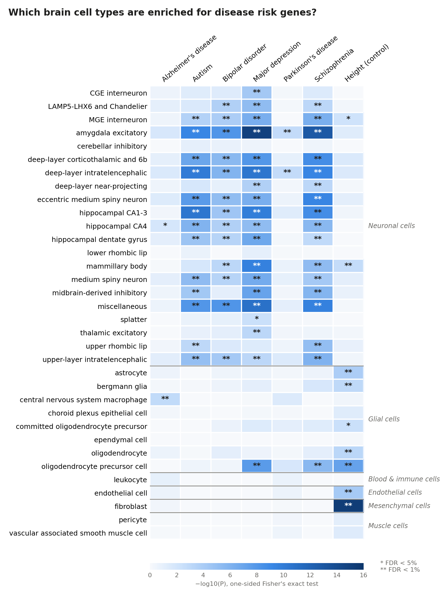
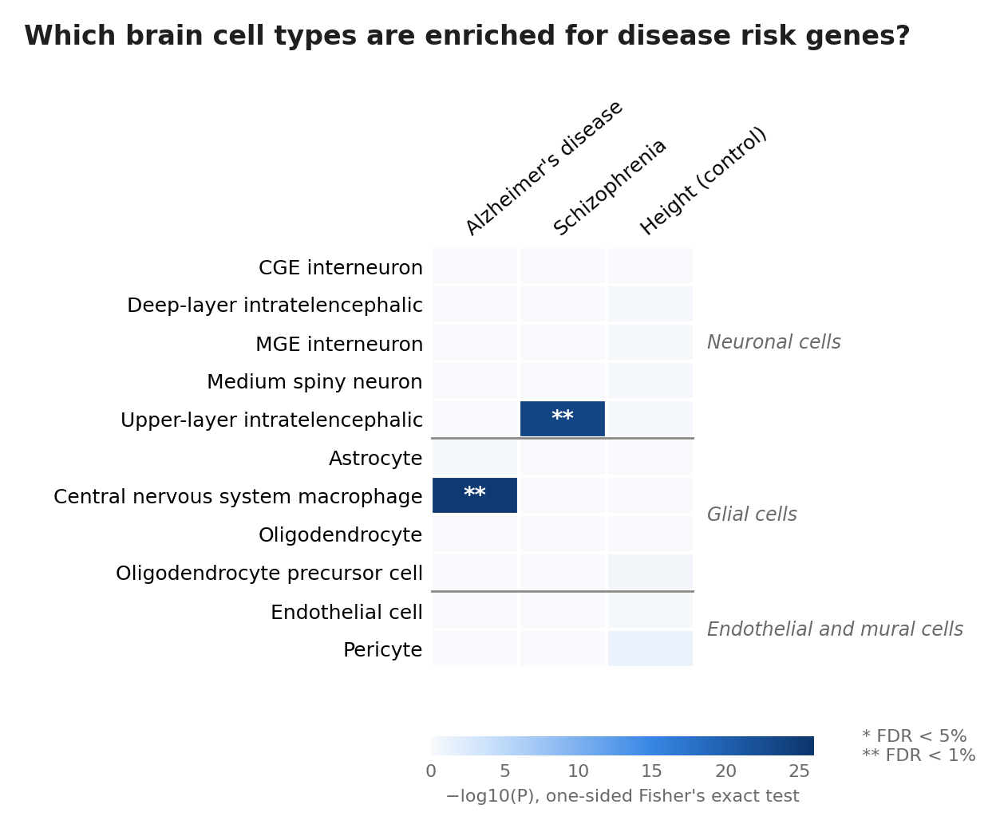

# Which brain cells carry the genetic risk for brain disorders?


Genome-wide association studies (GWAS) have linked hundreds of genes to
schizophrenia, Alzheimer's, Parkinson's, depression and autism. But the brain is
made of dozens of very different cell types, and a gene list alone doesn't tell
us **which cells** a disease acts through.

This project combines a **single-cell atlas of the human brain** with the **GWAS
Catalog** to ask: for each disorder, are its risk genes concentrated in the genes
that define a particular brain cell type?

## Results



**Psychiatric disorders point to neurons.** Risk genes for schizophrenia, bipolar
disorder, major depression and autism are enriched across many neuron types,
most strongly in amygdala excitatory neurons, deep-layer cortical neurons and
hippocampal CA1–3 neurons (for example schizophrenia in amygdala excitatory
neurons: 134 risk genes vs 71 expected, odds ratio 2.2, FDR 1×10⁻¹¹). Astrocytes,
oligodendrocytes and microglia show no enrichment for these traits; the one glial
exception is oligodendrocyte precursor cells for schizophrenia and depression. This agrees
with earlier studies using different data and methods
([Skene et al. 2018](https://doi.org/10.1038/s41588-018-0129-5);
[Bryois et al. 2020](https://doi.org/10.1038/s41588-020-0610-9)).

**Alzheimer's disease points to microglia.** Alzheimer's is the only trait enriched
in the brain's immune cells (central nervous system macrophages, i.e. microglia;
odds ratio 1.4, FDR 0.005). The overlapping genes include the best-known
microglial Alzheimer's genes, **TREM2, CD33, SPI1, INPP5D, PLCG2, ABI3, CR1 and
the MS4A cluster**, recovered here without any prior knowledge of microglia.

**The negative control behaves as expected.** Height risk genes are enriched in
fibroblasts, vascular cells and glia, consistent with growth and
connective-tissue biology, and are only weakly enriched in two neuron types. A method biased
toward neurons, for example by the long length of neuronal genes, would have
pushed height toward neurons too, so the psychiatric results are unlikely to be
that artifact alone.

**Parkinson's disease is only weakly enriched** (two neuron types, FDR 0.005). The
cells thought to matter most, midbrain dopamine neurons, are not a separate cell
type in this atlas, which limits what this dataset can show for Parkinson's.

The genes behind every significant result are listed in
[`results/top_hits.md`](results/top_hits.md).

## Data

| | Source | Size |
|---|---|---|
| Brain expression | [Human Protein Atlas v24](https://v24.proteinatlas.org/humanproteome/single+cell/single+nuclei+brain/data), single-nucleus brain atlas: average expression in **34 cell types** from ~2.5 million nuclei across 11 brain regions ([Siletti et al. 2023, *Science*](https://doi.org/10.1126/science.add7046)) | ~10 MB |
| Disease genes | [NHGRI-EBI GWAS Catalog](https://www.ebi.ac.uk/gwas/): all published genome-wide significant associations | one-time download |

Both are downloaded automatically by `run.py`.

## Method

1. **Cell-type signatures.** For each gene, *specificity* in a cell type is the
   share of the gene's total expression found in that cell type (1.0 = expressed
   only there). The top 10% most specific genes form each cell type's signature
   ([Skene et al. 2018](https://doi.org/10.1038/s41588-018-0129-5)).
2. **Risk genes.** For each trait, all GWAS Catalog associations with
   P < 5×10⁻⁸ are collected and mapped to genes (the gene containing the variant,
   or the nearest gene if it falls between genes). Traits are matched by ontology
   ID (EFO/MONDO), so differently worded studies of the same disease are pooled.
   The **MHC region** (chr6:25–34 Mb) is excluded: it holds hundreds of
   immune genes in tight linkage, and one schizophrenia signal there would
   otherwise add dozens of immune genes and bias results toward microglia.
3. **Enrichment.** For every trait × cell type pair, a one-sided **Fisher's exact
   test** asks whether risk genes fall in the signature more often than expected,
   with all expressed genes as background. P values are corrected with
   Benjamini–Hochberg FDR across all tests.
4. **Negative control.** Height is a highly polygenic trait with no reason to
   point at any brain cell type. If it showed strong enrichment, that would
   reveal a bias in the method rather than biology.

## Validation

The pipeline is tested on synthetic files in the exact HPA and GWAS Catalog
formats, with risk planted in known cell types plus decoy rows that must be
ignored (non-significant hits, MHC hits, unrelated traits). It recovers exactly
the planted signal:



Tests also check that the Fisher test is calibrated under the null (random gene
sets give P < 0.05 no more than ~5% of the time) and that the FDR correction
matches R's `p.adjust`. They run automatically on every push via GitHub Actions.

## Run it

```bash
pip install -r requirements.txt
python run.py --demo   # synthetic data, a few seconds, no internet
python run.py          # real data: downloads once, then runs in under a minute
pytest -q
```

Outputs in `results/`: `heatmap.png`, `enrichment.tsv` (every test, with the
overlapping genes), `top_hits.md`, and `risk_genes.tsv`.

## Project layout

```
├── run.py                    # one command runs everything
├── src/brainrisk/
│   ├── data.py               # downloading and loading HPA + GWAS Catalog
│   ├── risk_genes.py         # trait definitions, variant-to-gene mapping, MHC filter
│   ├── analysis.py           # specificity, signatures, Fisher test, FDR
│   ├── plotting.py           # heatmap
│   └── synthetic.py          # fake data with a known answer
├── tests/                    # unit + end-to-end tests
└── results/                  # figures and tables
```

## Limitations

- **Gene length.** Neurons express many long genes, and long genes are more likely
  to contain a GWAS hit by chance, which can inflate neuronal enrichment. The
  height control helps detect this; correcting for gene length directly is a
  natural next step.
- **Nearest-gene mapping.** The causal gene at a GWAS locus is often not the
  nearest one. Fine-mapping or eQTL-based mapping would be more accurate.
- **Pooled studies.** The GWAS Catalog mixes studies of different sizes and
  ancestries (mostly European), so gene lists differ in quality between traits.
- **Expression is not causation.** Enrichment shows where risk genes are
  *expressed*, which suggests but doesn't prove where disease begins.

## Possible extensions

- Use full GWAS summary statistics with [MAGMA](https://cncr.nl/research/magma/)
  gene-property analysis, which uses all SNPs (not only significant ones) and
  corrects for gene size and LD ([Bryois et al. 2020](https://doi.org/10.1038/s41588-020-0610-9)).
- Repeat with region-specific clusters (e.g. cortex vs cerebellum).

## References

- Siletti K. et al. (2023). Transcriptomic diversity of cell types across the adult human brain. *Science.*
- Skene N.G. et al. (2018). Genetic identification of brain cell types underlying schizophrenia. *Nature Genetics.*
- Bryois J. et al. (2020). Genetic identification of cell types underlying brain complex traits yields insights into the etiology of Parkinson's disease. *Nature Genetics.*
- Sollis E. et al. (2023). The NHGRI-EBI GWAS Catalog: knowledgebase and deposition resource. *Nucleic Acids Research.*
- Human Protein Atlas, proteinatlas.org

## License

MIT
